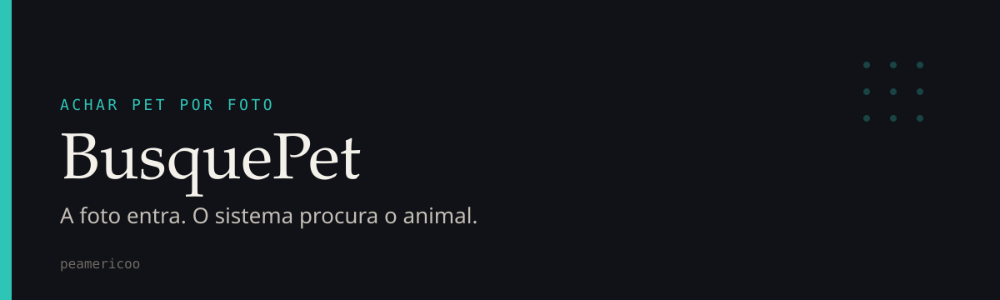

<div align="center">



Uma pessoa manda a foto de um animal perdido. Eu quero devolver candidatos parecidos, rápido, sem transformar isso num grupo de Facebook.

</div>

## O que é

BusquePet é o meu sistema para reencontrar animal por imagem. A porta da frente é uma API em Go. A comparação pesada fica no Python. No meio tem fila, cache e um websocket, porque ninguém merece ficar atualizando a página para saber se a busca acabou.

A ideia é simples: a foto chega, eu calculo um pHash, mando o trabalho para a fila, o modelo compara com o índice, e o resultado volta para quem está esperando.

## Para que serve

- Receber a foto de um animal e não perder o pedido no caminho.
- Comparar essa foto com um índice já treinado, usando hash perceptual e embedding.
- Avisar na hora quando a busca sai de "recebi" para "terminei".
- Deixar o treino do modelo separado da API que atende gente.

## Stack

| Camada | O que eu usei |
| --- | --- |
| API | Go 1.22, Chi, WebSocket |
| Fila e cache | NATS e Redis |
| Visão | Python, PyTorch, Transformers, PEFT, FAISS, pHash |
| Treino | ViT em cima do Oxford-IIIT Pet, treino contrastivo e LoRA |
| Entrega | FastAPI no webhook de matching, Docker Compose |
| Front | HTML, CSS e JavaScript. Direto, sem framework |

O front desta versão é uma página simples. Quem faz o trabalho é o pipeline.

## Como rodar

Precisa de Python 3.11, Go 1.22 ou mais novo, e os modelos já gerados. Sem o índice do FAISS e sem o checkpoint, a API sobe e a busca não tem com o que comparar.

Sobe a infra e os dois serviços:

```bash
mkdir -p shared-storage models data
docker compose up --build
```

Fica assim:

| Serviço | Onde |
| --- | --- |
| API Go | http://localhost:8080 |
| Webhook Python | http://localhost:8001 |
| Redis | localhost:6379 |
| NATS | localhost:4222, painel em 8222 |

Se for rodar na mão, o webhook primeiro:

```bash
export BUSQUEPET_MODEL_PATH=models/contrastive/best_model.pt
export BUSQUEPET_FAISS_INDEX=models/faiss_index
export BUSQUEPET_METADATA_PATH=data/embeddings/embedding_metadata.csv
export BUSQUEPET_WEBHOOK_PORT=8001
python3 -m uvicorn src.webhook_service:app --host 0.0.0.0 --port 8001
```

Depois a API:

```bash
export BUSQUEPET_STORAGE_DIR=$PWD/shared-storage
export BUSQUEPET_REDIS_URL=redis://localhost:6379/0
export BUSQUEPET_NATS_URL=nats://localhost:4222
export BUSQUEPET_PYTHON_WEBHOOK_URL=http://127.0.0.1:8001/v1/match
cd busquepet-go && go run ./cmd/busquepet-api
```

Manda a foto em `POST /v1/ingest`, no campo `image`. O retorno traz `job_id`, `status` e `phash`. O andamento está em `GET /v1/jobs/{job_id}` ou no websocket `/v1/ws`.

## O que tem aqui

| Pasta | Função |
| --- | --- |
| `busquepet-go/` | Recebe upload, normaliza a imagem, calcula pHash, guarda status no Redis, publica no NATS e empurra o resultado no websocket |
| `src/` | Treino, embeddings, índice FAISS e o webhook que devolve os matches |
| `frontend/` | A página para experimentar |
| `configs/` | Config de treino e de inferência |
| `docs/` | Pipeline, treino e o diagrama |
| `deployments/` | Imagem do webhook Python |

O contrato do match está em `POST /v1/match`. Entra o caminho da imagem já normalizada, o pHash e o `job_id`. Sai uma lista ranqueada com raça, score e distância.

Mais detalhe de treino e de pipeline: [docs/PIPELINE.md](docs/PIPELINE.md) e [docs/TRAINING_GUIDE.md](docs/TRAINING_GUIDE.md).

## Estado atual

O caminho de ingestão até o match está desenhado e ligado no Compose. A qualidade da busca depende do modelo e do índice que você colocar em `models/` e `data/`. Isso não vem versionado pronto para produção.

Para um teste seco, sem foto:

```bash
cd busquepet-go && go test ./...
python3 -m py_compile src/webhook_service.py
```

---

Pedro Américo Paletot. Conta [peamericoo](https://github.com/peamericoo).
