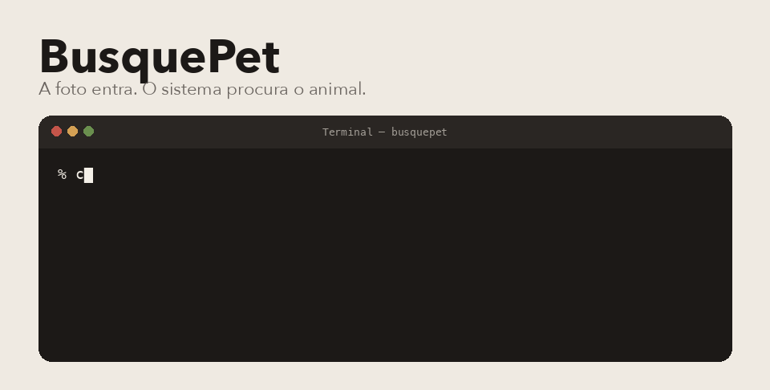

# BusquePet

<p align="center">
  
</p>

Uma foto de animal perdido entra. A API em Go guarda, tira um pHash e manda o trabalho para a fila. O Python compara com o índice. O websocket avisa quando acabou.

Não é rede social. É o cano entre a foto e um "achei uns parecidos".

## Como a foto anda

1. `POST /v1/ingest`, campo `image`.
2. A resposta traz `job_id`, `status` e `phash`.
3. O NATS chama o webhook Python em `POST /v1/match`.
4. O resultado fica no Redis e sai em `/v1/ws`, ou em `GET /v1/jobs/{job_id}`.

## Do que é feito

Go 1.22 na porta: Chi, Redis, NATS e websocket. Python no miolo: PyTorch, Transformers, PEFT, FAISS e pHash. Tem um ViT treinado em cima do Oxford-IIIT Pet. O front desta pasta é HTML, em `frontend/`. Sem framework.

## Subir

Python 3.11, Go 1.22, e os arquivos de modelo na mão. Sem o checkpoint e sem o índice do FAISS, a API sobe e a busca não tem com o que comparar.

```bash
mkdir -p shared-storage models data
docker compose up --build
```

| Serviço | Onde |
| --- | --- |
| API Go | http://localhost:8080 |
| Webhook Python | http://localhost:8001 |
| Redis | localhost:6379 |
| NATS | localhost:4222, painel na 8222 |

<details>
<summary>Rodar na mão, sem Docker</summary>

Webhook:

```bash
export BUSQUEPET_MODEL_PATH=models/contrastive/best_model.pt
export BUSQUEPET_FAISS_INDEX=models/faiss_index
export BUSQUEPET_METADATA_PATH=data/embeddings/embedding_metadata.csv
export BUSQUEPET_WEBHOOK_PORT=8001
python3 -m uvicorn src.webhook_service:app --host 0.0.0.0 --port 8001
```

API:

```bash
export BUSQUEPET_STORAGE_DIR=$PWD/shared-storage
export BUSQUEPET_REDIS_URL=redis://localhost:6379/0
export BUSQUEPET_NATS_URL=nats://localhost:4222
export BUSQUEPET_PYTHON_WEBHOOK_URL=http://127.0.0.1:8001/v1/match
cd busquepet-go && go run ./cmd/busquepet-api
```

</details>

## Onde mexer

- `busquepet-go/` recebe a foto, normaliza, publica no NATS e empurra o status no websocket.
- `src/` treina, monta o índice e responde o match.
- `docs/PIPELINE.md` e `docs/TRAINING_GUIDE.md` ficam para quando for treinar de novo.

Teste seco, sem foto:

```bash
cd busquepet-go && go test ./...
python3 -m py_compile src/webhook_service.py
```

O fluxo está ligado no Compose. Modelo e índice não vêm neste git.

Pedro Américo Paletot, [peamericoo](https://github.com/peamericoo).
